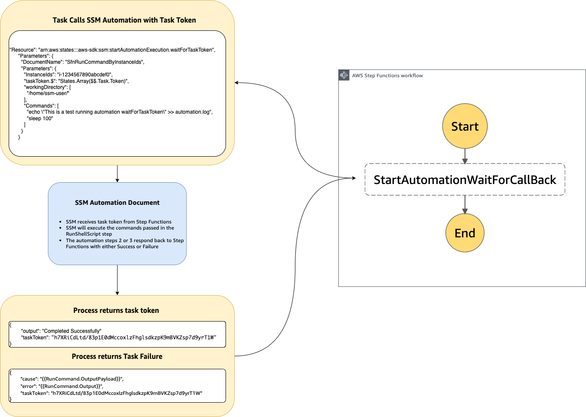

## Step Functions and Systems Manager Automation document .waitForTaskToken implementation

### Summary
In this pattern, we implement an automation document wrapper around AWS-RunShellScript or AWS-RunPowerShellScript execution for a AWS Step Functions waitForTaskToken integration. This will allow step functions to synchronously call an AWS-RunShellScript or AWS-RunPowerShellScript.

The following AWS Services are used in this pattern:
- AWS Systems Manager
- AWS Step Functions

#### Automation and scale
The Cloudformation template provided will deploy two Systems Manager Automation documents allowing to run synchronously AWS-RunShellScript or AWS-RunPowerShellScript task using Targets or Instance Ids from Step Functions:

- **SfnRunCommandByInstanceIds** - SSM documents allowing to execute AWS-RunShellScript or AWS-RunPowerShellScript by Instance Ids
- **SfnRunCommandByTargets** - SSM documents allowing to execute AWS-RunShellScript or AWS-RunPowerShellScript by Target
- **SSMSyncRole** - IAM Role assumed by the SSM documents

### Architecture

#### Target technology stack  
- AWS Step Functions
- AWS Systems Manager Automation

#### Target Architecture



### Details
AWS-RunShellScript document automation wrapper will execute the necessary step function api calls send_task_success upon successful execution and send_task_failure when errors occur.

The Cloudformation templates provided will deploy two Systems Manager Automation documents which allows to run automation command using Targets or Instance Ids:
- SfnRunCommandByInstanceIds
- SfnRunCommandByTargets

Each automation document consists of three steps to achieve a synchronous call when using (.waitForTaskToken) option in step functions.

|Step|	Action|	Description|
|----|--------|------------|
|1	|Branch|Checks the shell parameter value (Shell or PowerShell) to decide whether to trigger AWS-RunShellScript for Linux or AWS-RunPowerShellScript for Windows|
|2  |RunCommand_Shell or RunCommand_PowerShell|Takes several inputs and executes a RunShellScript or RunPowerShellScript command. Check details tab for more information|
|2	|SendTaskFailure|	Executed when step 2 is aborted or cancelled and consists of an AWS step function api |call (send_task_failure) having as input the token passed by the step function and the execution failure error and cause|
|3	|SendTaskSuccess|	Executed when step 2 is successful and consists of an AWS step function api call |(send_task_success) having as input the token passed by the step function|


### Automation documents parameters
#### SfnRunCommandByInstanceIds

|Name|	Type|	Description	|Default Value|
|----|------|---------------|-------------|
|shell|String|(Required) The instances shell to decide whether to run AWS-RunShellScript for Linux or AWS-RunPowerShellScript for Windows.|Shell|
|deliveryTimeout|	Integer|	If this time is reached and the command hasn't already started running, it won't run. Minimum value of 30. Maximum value of 2592000.	|3600|
|executionTimeout|	String|	(Optional) The time in seconds for a command to complete before it is considered to have failed. Default is 3600 (1 hour). Maximum is 172800 (48 hours).	|3600|
|workingDirectory|	String|	(Optional) The path to the working directory on your instance.|	""|
|Commands|	StringList|	(Required) Specify a shell script or a command to run.	|-|
|InstanceIds|	StringList|	(Required) The IDs of the instances where you want to run the command.	|-|
|taskToken|	String|	(Required) Step Function task token for callback response. |-|

#### SfnRunCommandByTargets
|Name|	Type|	Description	|Default Value|
|----|------|---------------|-------------|
|shell| String| (Required) The instances shell to decide whether to run AWS-RunShellScript for Linux or AWS-RunPowerShellScript for Windows.|Shell|
|deliveryTimeout|	Integer|	If this time is reached and the command hasn't already started running, it won't run. Minimum value of 30. Maximum value of 2592000.	|3600|
|executionTimeout|	String|	(Optional) The path to the working directory on your instance.	|3600|
|workingDirectory|	String|	(Optional) The path to the working directory on your instance.	|""|
|Commands|	StringList|	(Required) Specify a shell script or a command to run.	|-|
|Targets|	MapList|	(Required) An array of search criteria that targets instances using Key-Value pairs that you specify. Example: [{"Key":"InstanceIds","Values":["i-02573cafcfEXAMPLE","i-0471e04240EXAMPLE"]}]	|-|
|taskToken|	String|	(Required) Step Function task token for callback response	|-|


#### Sample step function StartAutomationExecution Task parameters 
```json
    "Resource": "arn:aws:states:::aws-sdk:ssm:startAutomationExecution.waitForTaskToken",
    "Parameters": {
            "DocumentName": "SfnRunCommandByInstanceIds",
            "Parameters": {
            "InstanceIds": ["i-1234567890abcdef0"],
            "taskToken.$": "States.Array($$.Task.Token)",
            "workingDirectory": [
                "/home/ssm-user/"
            ],
            "Commands": [
                "echo \"This is a test running automation waitForTaskToken\" >> automation.log",
                "sleep 100"
            ],
            "executionTimeout": [
              "10800"
            ],
            "deliveryTimeout": [
              "30"
            ],
            "shell": [
              "Shell"
            ]    
          }
        }
```
### Prerequisites and limitations
#### **Prerequisites and Limitations**
- AWS IAM permission to access all the mentioned AWS services should be in place.
- Ensure that SSM Agent is installed on the instance.
- Ensure AWS IAM instance profile with AWS Systems Manager permission is attached to the instance where the automation document will be executed.

#### **Product versions**
- Automation schema version 0.3
- SSM Agent version 2.3.672.0 or later

Architecture
Target technology stack  
AWS Step Functions
AWS Systems Manager Automation

### Deployment

#### **Create automation documents**

Go to Cloudformation choose create stack and upload the template referenced under [cloudformation/ssm-automation-documents.cfn.json](./cloudformation/ssm-automation-documents.cfn.json)
#### **Create pilot Step Function**

The below sample Step Function definition will call the automation document to execute two commands demonstrating the waitForTaskToken call to Systems Manager automation.

The Task will echo "This is a test running automation waitForTaskToken" into /home/ssm-user/automation.log then sleep for 100 seconds before responding back with the task token to release the next task in the step functions workflow.

Make sure to update the "InstanceIds" with a valid SSM enabled instance on your environment.

For more information on how to create a step function, please check https://docs.aws.amazon.com/step-functions/latest/dg/getting-started.html

```json
{
  "Comment": "Step function to synchronously call an AWS-RunShellScript or AWS-RunPowerShellScrip",
  "StartAt": "StartAutomationWaitForCallBack",
  "States": {
    "StartAutomationWaitForCallBack": {
      "Type": "Task",
      "Resource": "arn:aws:states:::aws-sdk:ssm:startAutomationExecution.waitForTaskToken",
      "Parameters": {
        "DocumentName": "SfnRunCommandByInstanceIds",
        "Parameters": {
          "InstanceIds": [
            "i-1234567890abcdef0"
          ],
          "taskToken.$": "States.Array($$.Task.Token)",
          "workingDirectory": [
            "/home/ssm-user/"
          ],
          "Commands": [
            "echo \"This is a test running automation waitForTaskToken\" >> automation.log",
            "sleep 100"
          ],
          "executionTimeout": [
              "10800"
            ],
          "deliveryTimeout": [
              "30"
            ],
          "shell": [
              "Shell"
            ]    
          }
        }
      },
      "End": true
    }
  }
}
```

#### **Update Step Function IAM Role**

The step function creation will generally create a dedicated role automatically with the function creation however it will not add rights to call SSM automation document. Update the role by adding the following permissions:

```json
{
            "Effect": "Allow",
            "Action": [
              "ssm:StartAutomationExecution",
              "ec2:DescribeInstances"
            ],
            "Resource": "*"
}
```

#### **JSONata Step Function Implementation**

The following enhanced Step Function definition demonstrates advanced JSONata integration with dynamic instance discovery and parameter transformation. This version automatically discovers running Linux instances and applies conditional logic for parameter assignment.

```json
{
  "Comment": "JSONata Step functions to synchronously call an AWS-RunShellScript or AWS-RunPowerShellScript",
  "StartAt": "DescribeInstances",
  "States": {
    "DescribeInstances": {
      "Type": "Task",
      "Arguments": {},
      "Resource": "arn:aws:states:::aws-sdk:ec2:describeInstances",
      "Next": "StartAutomationExecution",
      "Assign": {
        "timeout": "10800",
        "deliveryTimeout": "30",
        "osType": "linux"
      }
    },
    "StartAutomationExecution": {
      "Type": "Task",
      "Arguments": {
        "DocumentName": "SfnRunCommandByInstanceIds",
        "Parameters": {
          "InstanceIds": "",
          "taskToken": [""],
          "Commands": [
            "echo \"This is a test running automation waitForTaskToken\" >> automation.log",
            "sleep 100"
          ],
          "workingDirectory": ["/home/ssm-user/"],
          "executionTimeout": "",
          "deliveryTimeout": "",
          "shell": ""
        }
      },
      "Resource": "arn:aws:states:::aws-sdk:ssm:startAutomationExecution.waitForTaskToken",
      "End": true
    }
  },
  "QueryLanguage": "JSONata"
}
```
## Security

See [CONTRIBUTING](CONTRIBUTING.md#security-issue-notifications) for more information.

## License

This library is licensed under the MIT-0 License. See the LICENSE file.

## References
[Step Functions getting started](https://docs.aws.amazon.com/step-functions/latest/dg/getting-started.html)

[Step Functions service integration patterns [wait for CallBack]](https://docs.aws.amazon.com/step-functions/latest/dg/connect-to-resource.html#connect-wait-token)

[Step Functions boto3 api call send_task_success and send_task_failure](https://boto3.amazonaws.com/v1/documentation/api/latest/reference/services/stepfunctions.html)

[SSM Automation Documents](https://docs.aws.amazon.com/systems-manager/latest/userguide/systems-manager-automation.html)

## Appendices 
### Appendix A - JSONata Step Function Logic Explanation

#### **State 1: DescribeInstances**
- **Purpose**: Discovers all EC2 instances in the account
- **Resource**: `arn:aws:states:::aws-sdk:ec2:describeInstances`
- **Assign Block**: Sets variables for use in subsequent states:
  - `timeout`: "10800" (3 hours execution timeout)
  - `deliveryTimeout`: "30" (30 seconds delivery timeout)
  - `osType`: "linux" (target operating system)

#### **State 2: StartAutomationExecution**
Uses JSONata expressions for dynamic parameter transformation:

#### **Dynamic Instance Selection**
```jsonata
$states.input.Reservations.Instances[State.Name = "running" and $contains($lowercase(PlatformDetails), $osType)].InstanceId[]
```
- Filters instances that are **running** AND contain **osType**. value (assigned in previous state) which equals to **"linux"** in PlatformDetails, in my example. 
- Extracts only the `InstanceId` values
- `[]` ensures array output format

#### **Context-Aware Task Token**
```jsonata
$states.context.Task.Token
```
- Accesses Step Functions execution context
- Retrieves the task token for waitForTaskToken pattern

#### **Conditional Parameter Assignment**
```jsonata
/* Execution Timeout with Fallback */
[$timeout ? $string($timeout) : "3600"]

/* Delivery Timeout with Fallback */
[$deliveryTimeout ? $string($deliveryTimeout) : "30"]

/* OS-Based Shell Selection */
[$osType = "linux" ? "Shell" : "PowerShell"]
```

#### **JSONata Expression Patterns**

| Pattern | Purpose | Example |
|---------|---------|---------|
| `$states.input.*` | Access previous state output | `$states.input.Reservations.Instances` |
| `$states.context.*` | Access execution context | `$states.context.Task.Token` |
| `[condition ? value : default]` | Conditional with array wrapper | `[$timeout ? $string($timeout) : "3600"]` |
| `$contains(field, "text")` | String matching | `$contains(PlatformDetails, "linux")` |
| `$string(value)` | Type conversion | `$string($timeout)` |

#### **Key Advantages**
1. **Dynamic Discovery**: No hardcoded instance IDs
2. **Platform Filtering**: Automatically selects appropriate instances
3. **Conditional Logic**: Adapts parameters based on context
4. **Type Safety**: Ensures proper string conversion for SSM
5. **Fallback Values**: Provides sensible defaults

